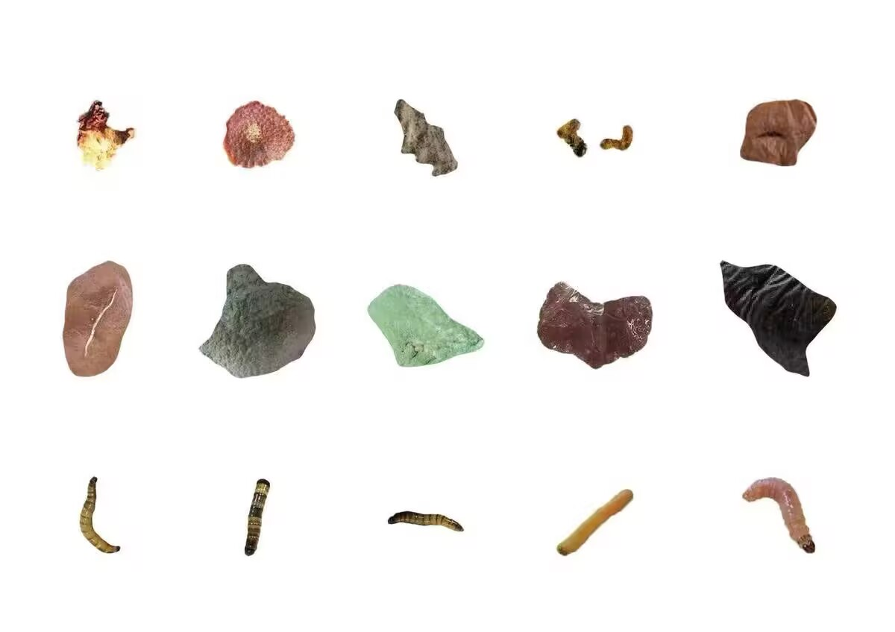

# 比赛规则
## 当前项目范围

- 当前识别和采摘对象：苹果、梨、南瓜、西红柿、辣椒、洋葱。
- 当前使用已有检测器的 `bad` 框禁止采收对应果实，不实现坏果、坏蔬菜摘除与丢弃。参考图片：

  

- 省级选拔赛明确不出现坏果或坏蔬菜。现有坏果否决仅防止误采，不满足完整赛事的摘除要求；后续须补回摘除并丢在场地内的流程。
- 省级选拔赛不包含 D 区。当前研发优先覆盖 A、B、C 区；D 区规则仍记录在本文中，便于后续扩展。
- 当前软件流程明确不实现前往收集更换区、导航返回起始区和到达起始区后的结束判定；`full` 完成 C 区后沿现有 C 区路径前往 `C_top_waypoint_1`，对齐航点 yaw 后按软件记录汇总播报。收尾规划或导航失败时仍直接汇总播报，其他入口结束位置不变。这是当前项目范围裁剪，不作为待补功能反复提出；比赛规则中的对应要求仍保留在本文供查阅。
- 独立 `acb` 入口提前扫码 B，完成 A/C 后在 `C_top_waypoint_2` 汇总，再执行 B1～B8。B8 后直接结束，不再次汇总。汇总点失败跳过播报，不宣称到达。该点是否满足赛事收集更换区判定仍须现场核对。

## 核心任务

正式比赛定位初始化每次最多等待 10 秒。首次失败时只重启 Point-LIO 和 `loam_interface` 一次，其他模块保持运行。第二次失败时报告错误，不启动 mission。

机器人要在完全自主、无遥控的情况下，从起始区出发，在随机布置的场地中完成导航、避障、二维码读取、果蔬种类与成熟度识别、抓取、机载收集和状态语音播报，任务完成后重新回到起始区。

## 单轮流程

1. 赛前 15 分钟内完成检录，否则原则上视为弃权。
2. 上场后有 3 分钟准备时间。机器人准备好时，看护队员举手示意裁判，裁判开始比赛计时。
3. 机器人放在起始区内；裁判发出开始指令后，只允许一名队员启动机器人。
4. 启动后机器人必须自主运行。A、B、C、D 区的作业顺序可以由机器人自行选择。
5. 比赛过程中可以随时到收集更换区转移已经收集的果蔬。
6. 完成计划任务后回到起始区，视为比赛结束；队伍也可以由看护员举手主动中止比赛。
7. 单轮最长 10 分钟，超时只计算前 10 分钟内取得的分数。


## 总体场地

- 场地外轮廓：`5200 mm x 3000 mm` 的黄色长方形区域。
- 围栏：四周约 `300 mm` 高。
- 地面：地毯上铺设 UV 刀刮布打印地图。
- 起始区：图示为 `500 mm x 500 mm`。
- 作业区按难度依次为 A、B、C、D；省级选拔赛不设置 D 区。
- 蔬菜放置点为 `200 mm x 200 mm` 正方形区域；果树放置点为直径 `200 mm` 的圆形区域。
- 场地、果蔬种类、成熟度、好坏、位置、悬挂高度和障碍物由志愿者现场布置，存在搭建误差，所有感知与运动逻辑都不能依赖理想坐标或完全一致的道具位置。
- A、B、C 区均有随机障碍物，但官方要求留有足够机器人通过的空间。

## A 区：普通菜地

- 放置 8 个蔬菜：5 个成熟、2 个不成熟、1 个坏蔬菜，种类和位置随机。
- 省级选拔赛不出现坏蔬菜。
- 有 2 个随机障碍物。
- 无二维码和规定采收顺序。
- 机器人应判断成熟度，只采收成熟蔬菜，并把成功采收的蔬菜放入机载存放装置。
- 完整规则中，坏蔬菜应被摘下并丢在场地内；当前项目暂不实现这一分支。

## B 区：现代化果园

- 共 8 棵果树、16 个果实，每棵树挂 2 个果实；同一棵树上的果实种类相同。
- 果树带模拟绿色藤蔓。果树种类、果实成熟度、好坏和悬挂位置随机。
- B 区果树位置按“由上到下、由左到右”的规则编号为 1 至 8，编号只存在于规则图和内部地图，实际场地没有号码牌。
- 入口有一个固定二维码牌。二维码产生 8 行果树名称，第 1 至 8 行依次对应 1 至 8 号果树位置。
- 进入 B 区后必须先读取二维码，判断并播报要采收的果实种类。
- 二维码补充材料进一步要求按二维码给出的顺序，对 1 至 8 号果树依次作业；当前实现应按顺序执行，不应自行重排 B 区树间路径。
- 只有“该位置的果树种类符合二维码要求”且“果实成熟”时才允许采收。
- 有 1 个随机障碍物。
- 完整规则中，坏果应摘下并丢在场地内；省级选拔赛不出现坏果，当前项目暂不实现这一分支。

## C 区：现代化开放菜地

- 有 12 个候选放置点，按“由上到下、由左到右”的规则编号为 1 至 12；号码只存在于规则图和内部地图，实际场地没有号码牌。
- 志愿者从 12 个位置中随机放置 8 个蔬菜，种类、成熟度和好坏随机。
- 入口有一个固定二维码牌。二维码给出 8 行数据，每行是一组“蔬菜名称 + 位置号码”。
- 8 行的行序就是强制作业顺序。机器人必须先读取二维码、播报采收顺序，再依次前往指定位置并稳定停车。
- 到达每个指定位置后，只有蔬菜种类与该行要求相符且成熟时才允许采收，并应把采收结果播报出来。
- 顺序错误时，本次不得分并扣 4 分；无论该次是否成功，下一次都应继续执行二维码的下一行，不能反复尝试上一行来恢复顺序。
- 有 2 个随机障碍物。
- 抓取时不能碰动其他尚未抓取的蔬菜使其离开预设正方形框，否则每个被移位蔬菜扣分。
- 完整规则中，坏蔬菜应摘下并丢在场地内；省级选拔赛不出现坏蔬菜，当前项目暂不实现这一分支。

## D 区：现代化开放果园

- 省级选拔赛不包含 D 区。
- 规则写作“27 棵果实”，结合“每棵果树挂 3 棵果实”和场地图，应理解为 9 棵果树、共 27 个果实；这是对原文明显量词错误的工程解释，现场仍以裁判解释为准。
- 同一果树的果实种类相同，果树种类、成熟度、好坏和悬挂位置随机。
- 没有二维码规定目标或顺序。机器人自主选择果树，检测属性，采收成熟果实并放入机载存放装置。
- 完整规则中，坏果应移除到场地内。

## 果树结构与果实悬挂

- 2026 年规则的重要变化：果实由原先的挂钩悬挂改为磁铁吸附悬挂，末端执行器应按磁吸脱离特性设计和测试。
- 模拟果实为塑料类圆形仿真水果；模拟蔬菜为塑料长条形仿真蔬菜。
- B 区果树约高 `400 mm`，圆形底盘直径约 `200 mm`，6 根枝干分两层布置，图示枝长约 `150 mm`。
- D 区果树约高 `600 mm`，圆形底盘直径约 `200 mm`，6 根枝干分三层布置，图示上层枝长约 `200 mm`、其余约 `150 mm`。
- 枝干绕树干约按 `120 deg` 方位分布、与树干图示夹角约 `60 deg`。这些是规则图示名义尺寸，程序和机构必须为现场安装偏差留余量。

## 二维码与任务状态机

### B 区二维码语义

将二维码解析为固定长度为 8 的目标数组：

```text
b_targets[1..8] = fruit_name
```

数组下标对应 B 区内部编号 1 至 8。机器人应先完成二维码解析和目标播报。二维码补充材料明确要求按二维码内容顺序到 1 至 8 号果树位置采收，因此 B 区任务也应作为有序队列执行：

```text
for position_id = 1..8:
    navigate -> identify -> announce -> pick_or_skip -> advance
```

不要为了缩短路径而重新排序。

### C 区二维码语义

将二维码解析为有序的 8 个任务：

```text
c_tasks[1..8] = (vegetable_name, position_id)
position_id in 1..12
```

`c_tasks` 必须顺序执行。对第 `i` 行，至少应有以下状态：

```text
NAVIGATE_TO_POSITION -> STABLE_STOP -> IDENTIFY -> ANNOUNCE -> PICK_OR_SKIP -> ADVANCE_TO_i+1
```

若目标不存在、种类不符、不成熟、识别置信度不足或抓取失败，应记录并跳过，但任务游标仍推进到下一行，避免后续全部错序。

## 计分理解

### 通用分数

| 项目 | 分值 | 完成条件 |
| --- | ---: | --- |
| 起点投影完全在框内 | 10 | 机器人全部垂直投影位于起始框内部 |
| 起点投影部分在框内 | 5 | 只有部分垂直投影在框内 |
| 起点投影不在框内 | 0 | 垂直投影不在起始框内 |
| 起始播报 | 10 | 从起点出发时由机器人自动播报参赛信息 |
| 收集更换区播报 | 10 | 到达收集更换区后准确播报果蔬收获情况；该项只取一次最高分，不累计 |

### 分区分数

| 区域 | 正向得分 | 主要扣分 |
| --- | --- | --- |
| A | 抓取成熟蔬菜 `+3/个`；放入机载装置 `+2/个`；移除坏蔬菜 `+2/个` | 误夹不成熟或坏蔬菜 `-4/个`；碰障碍物 `-5/次` |
| B | 评分表另列种类识别 `+5`；抓取合规成熟果实 `+3/个`；放入机载装置 `+2/个`；移除坏果 `+2/个` | 误夹不成熟、种类不符或坏果 `-4/个`；碰障碍物 `-5/次` |
| C | 评分表另列作业顺序 `+5`；按二维码到指定区域稳定停车 `+2/次`；正确识别并抓取成熟且种类正确的蔬菜 `+5/个`；放入机载装置 `+2/个`；移除坏蔬菜 `+2/个` | 误抓不成熟、种类不符或坏蔬菜 `-4/个`；不按顺序本次不得分且 `-4/次`；碰动未抓蔬菜使其离框 `-3/个`；碰障碍物 `-5/次` |
| D | 抓取成熟果实 `+3/个`；放入机载装置 `+2/个`；移除坏果 `+2/个` | 误夹不成熟或坏果 `-4/个` |

### 计分上的直接工程结论

- 一次合规采收通常包含两个独立计分动作：“抓取”和“放入机载存放装置”。规划和检测日志要能分别证明这两个事件。
- A、B、D 区一个完整正确目标通常为 `3 + 2 = 5` 分；C 区一个完整正确目标通常为 `5 + 2 = 7` 分，另可能获得到位停车的 2 分。
- C 区到点稳定停车本身就有分。即使目标不满足采收条件，也应可靠完成到点、停车、识别、播报和跳过，避免因乱序产生额外扣分。
- 障碍物碰撞每次扣 5 分且没有上限。应把保守避障优先级放在多拿一个低价值目标之前。
- 在 A、B、C 区碰到随机障碍物均扣分；规则未列出 D 区障碍物碰撞项。
- 破坏场地会直接终止比赛。抓取力、底盘运动、机械臂扫掠范围和故障恢复必须以“不损坏道具”为最高约束。

### 掉落与拖拽判定

- 蔬菜在抓取时先离地后又掉回地面，该蔬菜之后不能再次采收；即使继续抓，后续收获环节不计分。
- 蔬菜被沿地面拖动，超过一半体积离开放置正方形区域，并且末端执行器随后与其脱离，则该蔬菜之后不能再次采收；继续采收也不计分。
- 因此抓取状态机必须区分“尚未抓取”“已成功抓取”“掉落后失效”“拖出后失效”，不能把失败目标无限重试。

## 语音播报要求

语音是裁判判定的重要依据，不只是展示功能。至少覆盖以下事件：

- 起点：自动播报参赛信息，以争取起始播报 10 分。
- B 区二维码：播报需要采收的果实种类或目标信息。
- B 区逐树判断：播报果实属性和本次采收/跳过决策。
- C 区二维码：播报 8 项蔬菜采收顺序。
- C 区逐点判断：播报位置、识别结果和采收/跳过决策。
- D 区：播报检测结果和采收/移除决策。
- 收集更换区：准确播报当前果蔬收获情况，以争取该项 10 分。

播报必须由机器人自动触发、内容与内部任务状态一致、声音足够清晰。没有播报只会失去对应加分，但声音太小或内容不清还可能导致裁判无法确认动作，误判风险由队伍承担。

当前 `fruit_mission` 的实际播报顺序和正常、异常分支示例见 [`docs/VOICE_FLOW.md`](VOICE_FLOW.md)。
