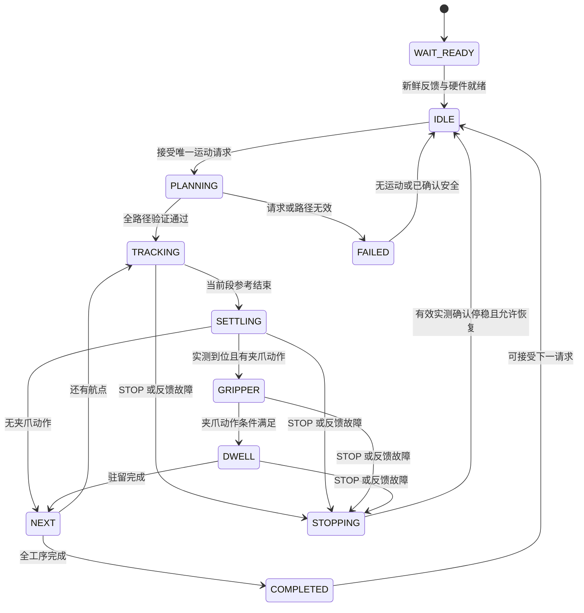

# 01. 架构与执行流程

本文是实施前设计，所有新行为尚未实现。
上层兼容基线见 [原 API](../../fruit_arm_planner/docs/03_INTERFACES_AND_API.md)。
访谈决定和待确认项见 [设计评审](04_DESIGN_REVIEW.md)。

## 1. 控制职责

| 职责 | 新上位机包 | 通信桥 | 下位机 / 驱动器 |
| --- | --- | --- | --- |
| Cartesian IK、FK、TCP 和关节映射 | 负责 | 不参与 | 不参与 |
| PTP/LIN、运动参考和预设顺序 | 负责 | 不参与 | 不参与 |
| 运动时间推进和各轴同步目标 | 负责 | 保持命令数据语义 | 应用当前目标 |
| 到位容差、停稳窗口、工序完成 | 负责 | 不参与 | 只回传实测 |
| 夹爪 OPEN/CLOSE/HOLD 与驻留 | 负责 | 传输数据 | 舵机执行当前目标 |
| 电机模式、位置、速度及可选力矩设定 | 选择并生成 | 传输数据 | 执行驱动器调用 |
| 帧封装、ACK、重发和传输日志 | 不参与 | 负责 | 对接桥的传输协议 |
| 驱动器电流环、位置环和厂商总线 | 不在 ROS 中实现 | 不参与 | 驱动器与硬件适配负责 |
| 急停、硬限位、过流、过温和失联保护 | 请求并观察 | 优先传输 | 本地执行保护 |

“上位机全权控制”指运动与动作决策归上位机。
它不要求通过普通 ROS 和串口运行电机的高速电流环。
下位机可重复发送最新设定值，满足电机总线刷新要求，但不得生成任务轨迹。
下位机不解算、不缓存整条轨迹、不判定水果抓取成功，也不自行 Home。

## 2. 对 mission 保持的接口

未来新节点继续使用 ROS 名称 `arm_planner_node`，内部包名为 `fruit_arm_controller`。
同一运行会话只启动新旧节点之一，禁止两个控制源并存。

| 原端点 | 类型 | 新包行为 |
| --- | --- | --- |
| `/arm_planner_node/move_cartesian` | `fruit_arm_interfaces/srv/MoveArmCartesian` | 原 XYZ、pitch、duration、gripper、linear_path 语义 |
| `/arm_planner_node/move_joints` | `fruit_arm_interfaces/srv/MoveArmJoints` | 原四轴硬件角度，输入为度 |
| `/arm_planner_node/execute_preset` | `fruit_arm_interfaces/srv/ExecuteArmPreset` | 按原名称执行预设 |
| `/arm_planner_node/home` | `std_srvs/srv/Trigger` | 执行配置中的 `home` |
| `/arm_planner_node/stop` | `std_srvs/srv/Trigger` | 中断业务动作并请求停机 |
| `/arm_planner_node/emergency_stop` | `std_srvs/srv/Trigger` | 请求硬件急停并锁止继续运动 |
| `/arm_planner_node/reload_presets` | `std_srvs/srv/Trigger` | 空闲时校验并原子替换 presets |
| `/arm_planner_node/cmd_cartesian` | `geometry_msgs/msg/PointStamped` | 保持固定根部坐标、pitch=0、PTP 的调试输入 |
| `/arm_planner_node/cmd_joints` | `sensor_msgs/msg/JointState` | 保持四轴硬件弧度与现有 effort 时间约定 |
| `/arm_planner_node/cmd_preset` | `std_msgs/msg/String` | 按名称调用预设 |
| `/arm_planner_node/joint_states` | `fruit_arm_interfaces/msg/ArmTelemetry` | 实测硬件角、模型角、TCP 和上位机执行状态 |
| `/fruit_hardware_bridge/arm/status` | `fruit_hardware_interfaces/msg/ArmStatus` | 由新节点发布的兼容状态输出 |

最后一个话题必须保留，因为 `CameraTargetPlannerClient.is_stationary()` 直接使用它。
新下位机原始反馈使用新端点，不能再同时向兼容状态话题发布旧业务状态。
兼容状态与 ArmTelemetry 必须来自同一有效实测快照。

`trajectory_id` 继续作为上位机动作编号，服务返回字段保持不变。
`success=true` 必须表示上位机通过新鲜反馈确认动作完成。
发布成功、传输 ACK、计划时间结束都不能作为动作成功证据。
STOP/ESTOP 的 Trigger 成功仍表示请求已发布，不表示已停稳。
ROS service future 被客户端取消，不会自动变为服务器 STOP，客户端仍调用独立 STOP 服务。

旧控制台的命令和遥测可复用，其旧 Header/Point/Mode 监听不再表示新方案的下发数据。
实施时需调整调试日志订阅，不能宣称所有内部诊断话题都保持不变。

## 3. 坐标和算法复用

复用现有 `RobotKinematics`、`JointTransformer` 和轨迹数学。
第一阶段优先保留 Python/rclpy，避免为了架构变化重写已验证的 IK。
该方案是上位机软实时设定值控制，不承诺硬实时调度。
周期抖动超出电机要求时，再根据测量决定是否迁移执行器循环。

四个模型角为 yaw、肩相对水平、肘相对大臂、腕相对小臂。
模型 Q3 与硬件 Q3 的肩部耦合，继续由 `JointTransformer` 处理。
硬件角与厂商编码器原始值必须区分，转换边界见数据契约。
不得同时在 NUC 和 MCU 添加相同零位偏置。

Cartesian XYZ 表示真实解算位置，即真实夹爪 TCP。
`geometry.a4` 与 `tool_z_offset_m` 构成随腕部旋转的刚性偏移。
`pitch=0°` 仍表示 a4 段水平，不改变现有相机外参。
反馈必须保持实测值，不能用下发目标替代位置或伪造零速度。

## 4. 单次运动流程

该图只描述业务流程，ESTOP 可从任何状态进入急停锁定。
错误结果和锁定状态由具体故障决定，不因 service 返回而自动解除。

1. 校验请求、占用权、硬件就绪与每个姿态轴反馈。
2. 冻结实测硬件角，以 HOLD 和实测角作为 t=0 参考。
3. 在上位机生成整条 PTP/LIN 路径并验证限位与导数约束。
4. 使用单调时钟推进参考时间，每周期只发送当前设定值。
5. 参考段结束后，持续保持终点设定值并检查实测到位。
6. 实测到位后执行该航点夹爪动作，再计算驻留时间。
7. 全部段完成后，返回成功并输出兼容 COMPLETED 状态。

每个航点配置是否等待实测到位并停稳，不实现自动绕行。
拟采用航点布尔字段 `wait_until_settled`，默认值待第二轮确认。
过渡点、夹爪动作点与最终点的推进规则也需在第二轮明确。
整条路径应预先验证，逐段启动时还需检查实测起点的连续性。
明显偏离预先验证路径时返回失败，不临时补造未校验运动。

规划与反馈、STOP 回调必须独立可执行。
控制循环不等待串口 ACK，也不阻塞等待 service future。
周期错过时跳过旧设定值，不补发历史周期造成命令积压。
出现超过允许连续性范围的跳变时，停止发送运动目标并请求 STOP。

## 5. 参考生成与控制频率

PTP 保持现有五次多项式形状，生成硬件位置及速度参考。
LIN 保持 TCP 直线和 pitch 插值，在上位机逐点 IK 后映射硬件角。
复用每段数学，不直接消费旧拼接轨迹里的夹爪时间标记。
夹爪和驻留改由实测到位事件推进，避免计划时间到了就提前夹取。
LIN 按新执行周期或经验证的密集采样生成参考。
不能把旧 200 ms 稀疏关节点直接线性重采样，就声称中间 TCP 仍在直线上。
速度通过同一参考轨迹及映射求导，不能忽略 Q3 耦合。
LIN 的有限采样不构成无碰撞保证。

下位机只收到当前设定值，不收到未来点表或执行时刻表。
位置速度模式是否把速度当有符号参考或正值速度上限，须由电机型号确认。
不得把厂商速度上限字段直接当作参考导数。

初步评估 20–50 Hz 的上位机下发，最终频率由链路和反馈实测决定。
这不是已验证的默认配置，不能从旧 `interpolation_step_ms: 200` 直接推导新周期。
驱动器内部伺服频率和 MCU 的总线刷新频率可以更高。

沿用原 `duration_ms` 作为参考运动时长，不作为完成期限。
过短时长若违反已确认的速度或加速度限值，返回无效请求。
第一版不自动拉长用户指定时长。
该选择已由用户确认。
关节电机首版采用位置控制，力矩数据用于观测和保护，不采用 MIT/阻抗控制。

## 6. 上位机到位判断

每个姿态轴同时满足位置误差和低速度条件，并持续满足配置稳定窗口。
新到位判断只能使用本次动作开始后的有效反馈。
终点完成检查还需确认终点命令已应用，并使用其后的实测样本。
必须检查每个执行器样本年龄，不能把新回传帧内的旧缓存当新反馈。
任一新样本不满足条件或反馈中断，稳定窗口重新开始。

关节请求以硬件角误差为主要条件。
Cartesian 请求增加 FK TCP 位置与 pitch 误差条件。
肩部耦合及旋转角连续区间按配置处理，禁止对所有轴盲目使用 360° 环绕。
容差、低速阈值和窗口来自测量，文档不预设一组未经验证的数值。

用户已明确：超时、空抓等非硬件失败不能永久拒绝后续操作。
原草案的无限等待可能使一次动作占住服务，完成等待策略待第二轮确认。
动作未完成不能伪装为 success=true，返回失败也不等于必须锁止整个控制器。
区分请求无效、业务动作未达标、硬件故障及运动状态未知。
前两类不建立硬件故障锁，满足有效反馈和停稳条件后可接受后续请求。
硬件故障或运动状态未知时仍需停止并核实硬件状态。
软件流程继续不表示可以在失联或未知运动时继续下发目标。
节点不自动重抓、回退或 Home，比赛终止或继续策略属于 mission。
用户要求普通采摘失败跳过并继续，不因一次失败终止比赛。

`progress` 保持 0–100 百分比。
进度描述参考推进，不描述电机反馈质量，到位和夹爪完成前不得标为 100。
兼容状态使用现有 IDLE/RUNNING/COMPLETED/FAILED/EMERGENCY 常量。
未知硬件错误不能伪装成 ERROR_NONE，新增错误码须在实施阶段协调定义。

## 7. 夹爪与腕部

腕部参与四轴姿态控制，夹爪独立控制。
飞特舵机的位置、速度与可用加速度参数由上位机生成。
具体型号不支持的参数不得发送或声称生效。

OPEN 转换为配置中的张开位置目标，实测到位后视为动作完成。
CLOSE 在第一次确认接触时可以返回动作完成，无须等到空夹爪闭合终点。
返回后仍维持抓紧，果实松动时继续闭合，直到完全闭合或收到覆盖命令。
这项持续策略独立于机械臂服务占用，不能阻塞下一段机械臂运动。
返回完成不取消持续抓紧，也不创建第二个硬件控制源。
持续抓紧由同一个控制节点统一生成夹爪设定值。
“持续给力”如何由具体舵机实现仍需确认，不能把位置误差自动等同于夹持力。
可依据实测位置、速度及型号支持的负载/电流判断接触，但阈值需台架标定。
电流或负载值不能未经标定就当作夹持力。
完成夹爪动作不等于证明果实已抓牢，水果成功判断属于上层感知与任务逻辑。

HOLD 对持续抓紧策略的影响待第二轮确认。
OPEN 必须覆盖持续抓紧，避免已请求松开却再次闭合。
初始 HOLD 需要有效夹爪位置或已确认安全目标，不能代入零位置。
持续发送相同夹爪设定值不得反复重启舵机内部动作曲线。
`dwell_ms` 从夹爪动作条件满足后开始计时，期间保持机械臂终点和夹爪目标。
无夹爪动作时保持原有 dwell 的解析语义，不额外添加等待。
单次运动服务无 dwell 字段时，完成动作后仍允许 mission 继续提交既有 HOLD 驻留请求。

## 8. 预设及配置复用

实施时把当前 `config/arm_presets.yaml` 的内容迁入新包 `config/`。
保留 `arm_planner_node.ros__parameters` 根节点，便于原工具读取。
保持 geometry、joint_mapping 和 presets 的值、注释、名称及航点类型。
以实施时的工作区文件为准，不能从旧提交恢复覆盖用户当前标定。

航点 `linear: true` 仍为 LIN，false 或省略仍为 PTP。
`cartesian`、`link_angles`、`joints` 的角度与单位约定不变。
本次不引入预设层 `linear`，也不迁移 XYZ 数值。

旧 `mode_start_delay_ms` 属于旧批量下发流程，新方案不使用它。
控制周期、导数约束、到位容差与执行器能力另放新包 `config/control.yaml`。
旧 planning 中有效的默认时长、驻留和反馈新鲜度继续使用。
应注明旧插值参数与新下发周期的区别，不能让一个参数隐式控制两者。

完成切换后，所有调用方和控制台只指向同一份源码配置。
`camera_extrinsic.yaml` 的 `arm_config_path` 及控制台路径必须同步迁移。
否则新包虽然接收原服务，客户端仍可能用旧映射校验新反馈。
预设重载只更新 presets，其他控制参数及标定修改要求安全重启。
